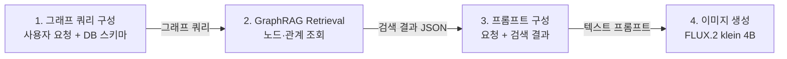

# CLINIQUE_test

지식 그래프에서 찾은 상품 정보로 온라인 쇼핑몰 **상품 상세 페이지 이미지**를 만드는 파이프라인을 시험하는 프로젝트입니다.
대상은 뷰티 브랜드 CLINIQUE의 상품입니다.

## 파이프라인



뒤 단계부터 거꾸로 구현하고 있습니다. 지금은 2단계 검색이 끝났다고 가정하고, **검색 결과 JSON에서 시작해 3단계 프롬프트 구성과 4단계 이미지 생성만** 구현되어 있습니다.

| 단계 | 상태 |
|---|---|
| 1. 그래프 쿼리 구성 | 미구현 |
| 2. GraphRAG Retrieval | 미구현. 결과를 [data/keypoint_retrieval.json](data/keypoint_retrieval.json)으로 가정 |
| 3. 프롬프트 구성 | [build_prompt.py](build_prompt.py) |
| 4. 이미지 생성 | [generate_image.py](generate_image.py) |

## 생성 방식

상세 페이지는 섹션별 이미지 여러 장으로 만듭니다.

1. 제품 설명
2. 키포인트
3. 성분
4. 효능
5. 브랜드
6. 소비자 테스트
7. 신뢰 배지
8. 사용 방법
9. 루틴

지금은 **2. 키포인트** 섹션 한 장을 대상으로 시험합니다. 제품은 드라마티컬리 디퍼런트 모이스춰라이징 젤입니다.

이미지와 글자를 합치는 방식은 두 가지를 비교할 계획입니다.

| 방식 | 내용 | 상태 |
|---|---|---|
| ① 통째로 생성 | 글자, 제품, 배경을 이미지 모델이 한 번에 그림 | **구현됨** |
| ② 비주얼 생성 + 글자 합성 | 모델은 글자 없는 비주얼만 그리고, 글자는 코드로 얹음 | 예정 |

## 폴더 구조

```
CLINIQUE_test/
├── data/
│   └── keypoint_retrieval.json      # 2단계 그래프 검색 결과 (가정)
├── assets/                          # 파일 저장소 역할. 그래프의 이미지 uri는 이 폴더 기준 상대 경로
│   └── products/dd-gel/front.png    # 제품 정면 사진 (투명 배경 PNG)
├── build_prompt.py                  # 3단계: JSON → 프롬프트
├── generate_image.py                # 4단계: 프롬프트 + 제품 사진 → 이미지
├── requirements.txt
└── output/                          # 실행하면 생성됨
```

## 입력: 그래프 검색 결과

### 가정한 그래프 구조

```
(Brand)-[:HAS_PRODUCT]->(Product)
(Product)-[:HAS_CLAIM]->(Claim {text, type})
(Claim)-[:SUPPORTED_BY]->(Evidence {type, period_start, period_end})
(Evidence)-[:COVERS]->(Product)
(Product)-[:HAS_IMAGE]->(Image {uri, view, background})
(Brand)-[:HAS_DESIGN_GUIDE]->(DesignGuide)
(DesignGuide)-[:HAS_COLORS]->(Palette {main, sub})
(DesignGuide)-[:HAS_TYPOGRAPHY]->(Typography {font_family, title_px, subtitle_px, body_px})
```

- 제품 사진 파일은 그래프 밖의 파일 저장소에 있습니다. 그래프의 `Image` 노드에는 저장소 안의 상대 경로(`uri`)와 설명(`view`, `background`)만 저장합니다.
- 판매 실적 근거(`Evidence`)는 로션+와 젤을 합산한 데이터라서, 두 제품 모두에 `COVERS`로 연결합니다.
- 브랜드 디자인 규칙은 특정 제품이 아니라 브랜드에 딸린 정보로 둡니다.

### 검색 결과 JSON

```json
{
  "claim": "전 세계적으로 4초에 1개씩 판매",
  "evidence": {
    "type": "내부 판매 데이터",
    "period": {"start": "2021-07", "end": "2022-07"},
    "covers": ["드라마티컬리 디퍼런트 모이스춰라이징 로션+", "드라마티컬리 디퍼런트 모이스춰라이징 젤"]
  },
  "images": [
    {"uri": "products/dd-gel/front.png", "view": "정면", "background": "투명"}
  ],
  "design": {
    "colors": {"main": "옐로·골드", "sub": "라벤더"},
    "typography": {"font_family": "Noto Sans KR", "title_px": 32, "subtitle_px": 24, "body_px": 16}
  }
}
```

## 3단계: 프롬프트 구성

**그래프에서 가져온 값만** 정해진 칸에 채웁니다. 그래프 밖에서 온 내용은 목적 문장 하나뿐입니다.
상품명, 배치(크기·위치·비율), 금지 규칙은 넣지 않습니다.

만들어지는 프롬프트:

```
[목적]
온라인 쇼핑몰 상품 상세 페이지의 '키포인트' 섹션 이미지 1장을 만든다.

[문구]
"전 세계적으로 4초에 1개씩 판매"

[근거]
- 유형: 내부 판매 데이터
- 기간: 2021-07 ~ 2022-07
- 대상 제품: 드라마티컬리 디퍼런트 모이스춰라이징 로션+, 드라마티컬리 디퍼런트 모이스춰라이징 젤

[제품 이미지]
- 첨부 이미지 1: 정면, 배경 투명

[브랜드 컬러]
- 메인: 옐로·골드
- 보조: 라벤더

[폰트]
- 글꼴: Noto Sans KR
- 글자 크기: 제목 32px, 부제목 24px, 본문 16px
```

제품 사진은 프롬프트 글자 안에 들어가지 않습니다. 4단계에서 `uri`로 파일을 불러와 프롬프트와 함께 모델에 넘깁니다.
사진의 순서는 프롬프트의 "첨부 이미지 N" 번호와 같습니다.

## 4단계: 이미지 생성

| 항목 | 값 |
|---|---|
| 모델 | [black-forest-labs/FLUX.2-klein-4B](https://huggingface.co/black-forest-labs/FLUX.2-klein-4B) (Apache-2.0), diffusers `Flux2KleinPipeline` |
| 입력 | 프롬프트 + 정면 사진 1장 (참고 이미지) |
| 단계 수 / guidance | 4 / 1.0 (모델 카드 예시 값) |
| 시드 | 0 (고정) |
| 출력 크기 | 지정하지 않음. 파이프라인이 첫 번째 참고 사진의 비율을 따름 |
| 투명 배경 처리 | 흰색(`FILL_COLOR`)으로 채워 넣음. 그냥 RGB로 바꾸면 투명한 부분이 검정이 됨 |

설정값은 [generate_image.py](generate_image.py) 맨 위에서 바꿀 수 있습니다.

## 실행 방법

### 필요 사양

- NVIDIA GPU, VRAM 약 13GB 이상 (모델 카드 기준: RTX 3090 / 4070 이상)
- 첫 실행 때 모델 약 16GB를 내려받습니다 (이미지 모델 약 7.8GB + 텍스트 인코더 약 8GB).
- 프롬프트 구성(`build_prompt.py`)만은 GPU 없이 표준 라이브러리로 실행됩니다.

### 설치

```bash
# 1. GPU의 CUDA 버전에 맞는 torch를 먼저 설치합니다: https://pytorch.org/get-started/locally/
# 2. 나머지 패키지를 설치합니다.
pip install -r requirements.txt
```

### 실행

```bash
python build_prompt.py      # 프롬프트와 첨부할 사진 경로 확인 (GPU 불필요)
python generate_image.py    # 이미지 생성
```

VRAM이 넉넉하면 `generate_image.py`의 `CPU_OFFLOAD`를 `False`로 바꾸면 더 빠릅니다.

### 결과

`output/`에 같은 이름의 파일 두 개가 생깁니다.

- `keypoint_YYYYMMDD_HHMMSS.png`: 생성된 이미지
- `keypoint_YYYYMMDD_HHMMSS.json`: 사용한 프롬프트, 참고 사진, 설정값, 출력 크기, 걸린 시간

## 현재 상태와 한계

- `build_prompt.py`는 실행해서 프롬프트가 위 내용과 정확히 같게 나오는 것을 확인했습니다.
- `generate_image.py`는 아직 GPU 환경에서 실행하지 않았습니다.
- 모델 카드에 "생성된 글자가 부정확하거나 왜곡될 수 있다"고 적혀 있고, 한국어 지원은 따로 언급이 없습니다. ①방식에서는 한글 문구가 깨질 수 있으며, 이 한계를 확인하는 것도 시험 목적의 하나입니다.

## 참고

- 제품 사진과 상품 정보는 시험용입니다. 상표와 이미지의 권리는 CLINIQUE에 있습니다.
